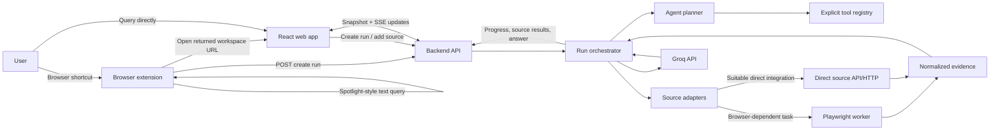

# Overall Architecture and Working Plan — Browser Research Agent

## 1. Purpose

This document explains how the Browser Research Agent's frontend, browser extension, backend, agent planner, source registry, Playwright automation, and Groq integration fit together. It is the coordinating architecture plan for implementation. The companion documents describe each component in greater detail:

- [project_description.md](project_description.md) — overall concept, goals, sources, constraints, and MVP.
- [frontend_description.md](frontend_description.md) — React workspace, Spotlight-style quick-search overlay, and browser extension interaction.
- [backend_description.md](backend_description.md) — API, run management, planning, Groq integration, and orchestration.
- [browser_automation_description.md](browser_automation_description.md) — Playwright lifecycle, source adapters, extraction, and isolation.

The product has two user-facing clients and two main server-side execution areas:

1. **Browser extension:** brings up the Spotlight-style query bar from a browser shortcut and submits the query.
2. **React web app:** displays the complete multi-panel research workspace in a separate tab.
3. **Backend and agent:** validates requests, plans research using a tool registry, manages runs, and synthesizes evidence through Groq.
4. **Source execution:** retrieves information through direct source adapters or an isolated Playwright browser worker.

The extension is included because the desired shortcut must work while a different browser tab is active. The extension is not the research workspace and does not perform source browsing. Playwright is not attached to the user's everyday browser; it runs separately under backend control.

## 2. Product behavior in one sentence

The user invokes the extension shortcut from a browser tab, enters a text query into a Spotlight-style overlay, and submits it; the backend creates a bounded research run, searches relevant registered sources, asks Groq to synthesize the collected evidence, and the web app opens in a new tab with the source panels and answer updating as work completes.

The user can also start a run directly from the web app's query screen. Inside the workspace, **+** adds a registered source panel and runs the active query through that source.

## 3. Architecture diagram

The diagram shows logical components; the first implementation may package the API, planner, orchestrator, and worker launcher in one backend repository/process. The source execution boundary should still be explicit so that Playwright can be separated into a worker process later if needed.

## 4. Component responsibilities

### 4.1 Browser extension

- Registers a user-configurable browser shortcut, within the browser's supported shortcut mechanism.
- Shows a centered Spotlight-style query bar over the current browser view, with a translucent/dimmed backdrop and optional blur, matching the supplied visual reference.
- Accepts text only; no voice/audio behavior.
- Submits the query to the backend create-run API.
- Opens the returned web-app workspace URL in a new tab.
- Provides an extension toolbar action as a shortcut alternative.
- Does not read the current page, scrape it, control Playwright, store the Groq key, or synthesize answers.

### 4.2 React web app

- Provides a home/query screen for users who open the app directly.
- Displays a research run by ID, including query, run status, selected sources, per-source panels, and AI synthesis.
- Loads a snapshot after initial navigation or refresh and subscribes to incremental run events.
- Provides the **+** source picker from the backend's registry response.
- Requests manual source execution for the current run and query.
- Displays partial successes, source failures, and synthesis failures without discarding successful evidence.
- Never receives or stores the Groq API key.

### 4.3 Backend API and orchestrator

- Serves the API to both extension and web app.
- Validates and normalizes incoming text, checks limits, creates run records, and returns an opaque run ID plus workspace URL.
- Owns the authoritative tool registry and validates every planned or manually selected tool.
- Coordinates planning, source execution, evidence normalization, synthesis, status tracking, and event publication.
- Stores enough run data to support workspace initial load and refresh according to the chosen MVP persistence approach.
- Keeps secrets and privileged operations server-side.

### 4.4 Agent planner and registry

- Interprets the user query and determines useful content types and sources.
- Selects only enabled tools from the explicit registry.
- Produces structured plan data, never executable instructions.
- Provides bounded source queries and optional user-readable rationale.
- Uses backend validation after model output so unknown tool IDs or excessive work cannot run.

### 4.5 Source adapters and Playwright worker

- Each source adapter implements a known source capability and returns common evidence fields.
- Direct API or HTTP adapters should be used where suitable and permitted.
- Playwright handles browser-rendered or interactive source flows that need a real browser.
- Playwright runs in isolated non-persistent contexts and never uses the user's personal profile.
- Browser-derived page content is treated as untrusted evidence, bounded and normalized before it reaches the planner or synthesis context.

### 4.6 Groq integration

- Groq is called only by the backend, using the user's API key configured server-side.
- The backend uses Groq for structured planning and evidence synthesis as needed.
- The selected model name and token/request limits are configuration values.
- The extension and web app never call Groq directly and never receive the key.
- Routine UI operations do not invoke the LLM.

## 5. End-to-end workflows

### 5.1 Quick search from any browser tab

1. The user presses the configured extension shortcut.
2. The extension opens its Spotlight-style overlay above the current tab and focuses the query field.
3. The user types a text question and submits it.
4. The extension sends `POST /api/v1/research-runs` with the query and a diagnostic `client_source` value of `browser_extension`.
5. The backend validates the request, creates the run, queues orchestration, and returns a run ID, initial status, and web-app workspace URL.
6. The extension opens that URL in a new tab. If opening is blocked, the extension presents a clear retry/open action; the web app itself can also be opened from the toolbar.
7. The web app loads `GET /api/v1/research-runs/{run_id}` and subscribes to the run's SSE event endpoint.
8. The planner selects sources from the registry. The backend starts source executions and emits source-added/status events.
9. Adapters search using direct access or the Playwright worker. Each returns bounded evidence with titles, URLs, snippets, and source identity.
10. The backend publishes source results as they arrive. Once sufficient evidence is available, it calls Groq for synthesis and publishes the answer with references to evidence IDs.
11. The workspace updates incrementally until the run completes, partially completes, fails, or is cancelled.

The extension should not wait for all research to finish before opening the workspace. It hands off quickly, and the workspace follows the run.

### 5.2 Query started from the web app

The web app's query composer calls the same create-run endpoint and opens or navigates to the workspace. The rest of the lifecycle is identical. This avoids two distinct orchestration paths.

### 5.3 Manual source addition using **+**

1. The workspace requests `GET /api/v1/tools` and displays available entries in the source picker.
2. The user chooses a source.
3. The web app calls `POST /api/v1/research-runs/{run_id}/sources` with the selected registered `tool_id`.
4. The backend gets the active query from the run, validates the tool and limits, and creates a source execution.
5. The backend emits `source.added`, status, and result events.
6. The workspace creates a panel immediately, then fills it with progress and results. The user does not re-enter the query.

### 5.4 Refresh or reconnect

When the workspace opens directly or reconnects after a network interruption, it fetches the current run snapshot and resumes the SSE subscription. The snapshot is authoritative for recovery; events update it incrementally.

## 6. Shared API and data contract

These endpoint names are the shared proposal from the backend plan and frontend plan. Final implementation should keep the four documents aligned to the same contract.

| Operation | Proposed endpoint | Purpose |
| --- | --- | --- |
| Create a run | `POST /api/v1/research-runs` | Accept query, create run, return run ID and workspace URL |
| Load current state | `GET /api/v1/research-runs/{run_id}` | Return query, statuses, evidence, and answer snapshot |
| Subscribe to updates | `GET /api/v1/research-runs/{run_id}/events` | SSE for status, source results, answer, and completion |
| List available tools | `GET /api/v1/tools` | Populate the web app's **+** picker |
| Add a source | `POST /api/v1/research-runs/{run_id}/sources` | Run active query through a chosen registered tool |
| Cancel a run (optional) | `POST /api/v1/research-runs/{run_id}/cancel` | Stop active source jobs if supported |

### 6.1 Create-run request and response

The request carries a bounded `query` and optional diagnostic `client_source` (`web_app` or `browser_extension`). It must not include an LLM key, user-supplied tool definitions, arbitrary browser instructions, or a client-selected unrestricted URL.

The response includes:

- Opaque `run_id`.
- Stored/normalized query.
- Initial status and selected sources if planning has already completed.
- `workspace_url` for the web app to open.
- `events_url` for SSE.

The returned workspace URL contains only the run identifier or another opaque reference; it never contains credentials.

### 6.2 Normalized evidence contract

Evidence shown by any source panel should use a common core shape:

- `evidence_id`
- `tool_id` and source display identity
- `title`
- `url` when available
- `snippet` or bounded extracted text
- Optional image/thumbnail and source-specific metadata
- `retrieved_at`

Each source execution has a stable `source_execution_id`, a query used, lifecycle status, bounded evidence array, and safe error information. The synthesis references evidence IDs actually returned by source adapters.

### 6.3 Event contract

The MVP uses SSE for server-to-client updates. Events include run/source IDs and stable event IDs or sequence numbers. Expected types:

- `run.status`
- `source.added`
- `source.status`
- `source.results`
- `answer.updated`
- `run.error`
- `run.completed`

Each event should be safe for frontend display and exclude internal prompts, secrets, raw stack traces, and unnecessarily large page text. On reconnect, the client can use event IDs for replay when supported, then reconcile with a snapshot.

## 7. Research-run lifecycle

Suggested run state progression:

`queued → planning → searching → synthesizing → completed`

Alternative terminal/partial states include `partial`, `failed`, or `cancelled`. Source panels have their own state: `queued`, `running`, `completed`, `empty`, `unavailable`, `failed`, `timed_out`, or `cancelled`.

Run completion rules should support partial success:

- A single failed source does not fail the full run if other sources produced useful evidence.
- Groq synthesis may begin after enough evidence arrives or after all planned sources finish, depending on latency and product choice.
- If Groq fails, preserve source results and mark synthesis unavailable.
- If all sources return empty/unavailable, do not fabricate an answer; return a clear status.
- Manual source additions remain attached to the run and update the workspace.

## 8. Planner, registry, and source execution flow

### 8.1 Plan generation

The backend sends the query and a compact registry description to the planner through Groq when reasoning is useful. The planner returns structured data such as task interpretation, selected tool IDs, per-source search terms, and optional rationale. The backend validates the response against the registry and run limits before dispatch.

For predictable simple cases, deterministic routing may be used to avoid an unnecessary model call. Planning and synthesis calls should be bounded and observable for cost control.

### 8.2 Tool registry as the boundary

Every source must have a registered ID, description, input/output schemas, execution adapter, enabled state, timeout, result limit, and documented limitation. Both planner-selected and user-added sources pass through the same validation path. Neither the model nor the clients can create arbitrary tools.

Potential registered tools include general web search, YouTube search, Wikipedia, image search, configured websites, and open-page extraction. The MVP should enable only sources with a usable and permitted adapter.

### 8.3 Execute sources

The orchestrator creates source execution IDs and runs selected adapters within a concurrency cap. Each adapter gets a validated query and per-source limits. Browser tasks are delegated to Playwright; direct integrations return through the same result-normalization boundary. Progress is published without waiting for all sources.

### 8.4 Normalize and synthesize

The backend standardizes results, removes duplicates, applies size bounds, retains canonical source links, and passes a bounded evidence bundle to Groq. Synthesis uses only returned evidence and asks the model to make uncertainty or missing evidence clear. The backend validates answer references and maps them to evidence IDs before publishing.

## 9. Browser extension and web app coordination

The extension and web app are separate frontends sharing the backend API:

- The extension needs only the permissions required to register the browser shortcut, display the popup/overlay or extension surface, and reach the backend/web-app origins.
- It sends query text and receives a workspace URL/run identifier.
- It opens the separate web app in a new tab.
- It does not need to read page contents for the agreed workflow.
- The web app owns the research run view, result panels, **+** control, event subscription, and reconnection.
- The API validates both clients like any other clients; an extension identity is not authorization to bypass validation.

The shortcut is browser-wide within supported browser extension behavior, not OS-wide across other applications. Shortcut registration and extension permissions need to be confirmed for the target browsers during implementation.

## 10. Playwright and browser-worker coordination

The backend starts only registered browser tasks with a source execution ID, tool ID, validated query, timeout, and result limits. The Playwright worker:

- Uses an isolated non-persistent browser context.
- Navigates only to approved destinations and follows bounded redirects.
- Uses resilient locators and bounded waits.
- Detects empty results, changed layouts, consent challenges, rate limits, and blocking pages.
- Extracts and sanitizes only useful fields.
- Returns normalized results or structured failure status.
- Closes contexts and pages after completion, cancellation, or error.

Direct source APIs or lightweight HTTP adapters should be used when more appropriate. Not all registered sources need Playwright. The worker never uses the user's browser profile, cookies, or extension state.

## 11. Groq and credit management

Groq is the chosen model API. The backend reads `GROQ_API_KEY` from server-side configuration and keeps it out of Git, extension bundles, frontend runtime config, URLs, event payloads, and logs. The exact model ID is an implementation-time configuration choice.

To keep usage predictable:

- Avoid calling Groq for panel movement, rendering, and routine UI actions.
- Bound planning and synthesis calls per run.
- Bound evidence size and output tokens.
- Clamp retries and use timeouts.
- Treat authentication and quota/rate-limit errors as clear failures, not endlessly retryable errors.
- Preserve source results if model use is unavailable.
- Show users in documentation/settings that their query/evidence may be sent to Groq and that API usage consumes their credits.

## 12. Data storage and deployment shape

### Local MVP

A simple local development setup can run:

- React app in the frontend development server.
- Browser extension loaded unpacked in a supported browser.
- Python API backend on a local development port.
- Playwright-managed browser binaries installed for the matching Playwright version.
- Groq API key in a backend-only ignored environment file.

The extension and web app must be configured to call the correct local backend origin. Backend CORS should allow only those development origins required by the chosen setup.

For the earliest single-user MVP, active run state may be in memory or SQLite. In-memory runs disappear on server restart; SQLite adds persistence but requires schema/version management. Choose one explicitly before implementation. If multi-user or remote deployment is planned, use a persistent database and appropriate authentication before exposing the service publicly.

### Production direction

The web app and API may be hosted separately or together. Playwright can run inside the backend host for a small MVP or move to an isolated worker service as concurrency grows. A production setup needs TLS, origin restrictions, authentication or another access boundary, secret management, request limits, job persistence, and worker resource isolation.

## 13. Security and privacy principles

- Keep Groq credentials on the backend.
- Treat extension and web app requests as untrusted; validate all queries, tool IDs, URLs, and optional source inputs.
- Treat model output as structured suggestions subject to registry validation, never as executable code.
- Treat retrieved page content as untrusted evidence and delimit it clearly in synthesis prompts.
- Protect Playwright against SSRF and unsafe redirects; block local/private/link-local/metadata targets as appropriate.
- Do not use the user's everyday profile, login cookies, or private tabs.
- Keep extension permissions minimal; the current flow does not require page-reading access.
- Bound run count, source count, concurrent browser contexts, navigation time, result size, and model tokens.
- Keep logs free of keys, cookies, authorization headers, full page dumps, and unnecessary user content.
- Explain that selected query/evidence content is sent to Groq for model operations.

## 14. Proposed implementation sequence

1. **Lock shared interfaces.** Confirm endpoint names, run/source IDs, status vocabulary, evidence schema, event names, storage choice, and initial source list across all four component plans.
2. **Build the backend skeleton.** Add configuration, health endpoint, run API, run store, tool registry, and source/result schemas without model or browser execution.
3. **Build the web app shell.** Implement the query screen, workspace route, status/panel components, API client, snapshot loading, and SSE handling against mock or local backend responses.
4. **Implement the extension quick-search surface.** Add shortcut registration, Spotlight-style overlay, query submission, new-tab handoff, and toolbar fallback. Keep it limited to the user's query and backend communication.
5. **Implement one end-to-end source adapter.** Pick a permitted and stable source, connect it through the registry and orchestration path, and render its normalized results in the workspace.
6. **Add Playwright worker isolation.** Implement lifecycle cleanup, navigation validation, timeouts, size limits, and a second browser-dependent adapter.
7. **Add Groq planning.** Parse structured tool selections, validate every proposed tool against the registry, and enforce source limits.
8. **Add Groq synthesis.** Pass bounded evidence with source IDs, validate references, and preserve source output when synthesis fails.
9. **Implement the + flow.** Populate the picker from `/tools`, call the manual-source endpoint, and show the new panel's run progress/results.
10. **Harden the MVP.** Add clear failures, partial-result behavior, reconnect handling, secret handling, privacy copy, source adapter toggles, and resource limits.
11. **Review the four documents together.** Update any final endpoint or schema decisions consistently before treating the plans as implementation contracts.

This sequence allows the UI and API to be developed in parallel after the contract is agreed, while keeping the extension, Playwright worker, and Groq client within their intended boundaries.

## 15. MVP definition

The MVP is complete when:

- The user can open the Spotlight-style extension search from a browser tab with a configurable shortcut or toolbar action.
- The user can submit a text query and reach its separate web-app workspace in a new tab.
- The web app can also create a run directly.
- The backend returns run identifiers and streams status and partial results.
- The agent uses the explicit registry and chooses a bounded set of sources.
- At least one browser-backed source and any selected direct integrations return normalized evidence with working source URLs.
- Groq produces a bounded synthesis grounded in evidence, using a key that remains backend-only.
- The **+** control adds a registered source panel and runs the active query without re-entry.
- Source errors, empty results, and Groq failures are handled without discarding successful outputs.
- Playwright uses isolated contexts and cannot navigate to unsafe targets under the defined policy.
- The extension does not read the active page or share browsing state with Playwright.

## 16. Decisions to make before implementation

- Initial target browser(s) and extension manifest/API level.
- Exact shortcut key and expected behavior when the browser reports a shortcut conflict.
- Whether the extension UI is a browser popup, an injected in-tab overlay, or a suitable combination. The desired appearance is overlay-like; implementation should match browser API capabilities and permissions.
- Exact frontend/backend development origins and production domain.
- Run persistence choice and expiration policy.
- Initial source adapters and which are direct versus Playwright-based.
- Exact Groq model ID and structured-output behavior.
- Worker process boundary, concurrency, timeouts, and result-size limits.
- Whether local-only use is the MVP deployment target or remote access is expected.

## 17. Architecture success criteria

The architecture is working as intended when each component has a clear, testable contract: the extension launches a run, the web app displays it, the backend coordinates it, the registry constrains available tools, Playwright retrieves bounded evidence in isolation, and Groq synthesizes only through the backend. Users should be able to follow where each result came from, and failure in one component should be visible without hiding successful work from the others.

## 18. Summary

The Browser Research Agent consists of a browser extension for quick, browser-wide query entry; a separate React web app for the full multi-panel workspace; and a Python backend that coordinates the agent, registry, source adapters, Playwright, and Groq. The extension launches research but does not browse sources. Playwright searches independently in isolated contexts. The backend validates tools, streams partial results, and keeps the Groq key secure. The component descriptions linked above provide the detailed plans; this file is their shared end-to-end architecture and implementation sequence.
